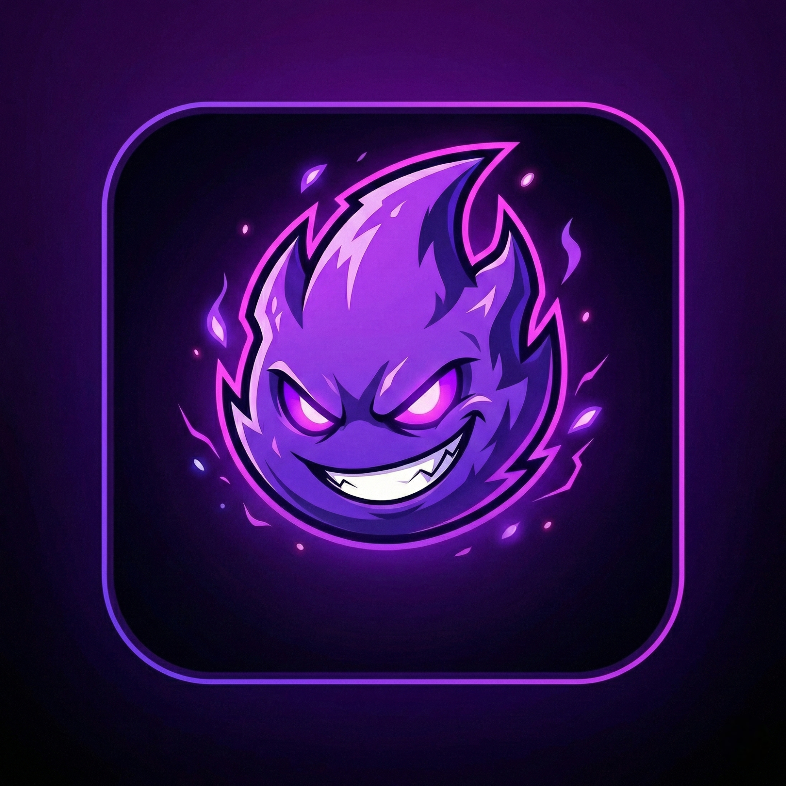

<div align="center">



# Nexus

**A full-stack, real-time voice & text chat platform built for the MENA region.**

[](https://fastapi.tiangolo.com/)
[](https://reactjs.org/)
[](https://www.mongodb.com/)
[](https://socket.io/)
[](https://www.electronjs.org/)
[](LICENSE)

[🚀 Live Demo](https://try-nexus.vercel.app) · [📖 API Docs](https://try-nexus.vercel.app/docs) · [🐛 Report Bug](https://github.com/Mo7ammadBitar/nexus-app/issues)

</div>

---

## 📋 Table of Contents

- [Overview](#-overview)
- [Features](#-features)
- [Tech Stack](#-tech-stack)
- [Architecture](#-architecture)
- [Getting Started](#-getting-started)
  - [Prerequisites](#prerequisites)
  - [Backend Setup](#backend-setup)
  - [Frontend Setup](#frontend-setup)
  - [Desktop App (Electron)](#desktop-app-electron)
- [Environment Variables](#-environment-variables)
- [Project Structure](#-project-structure)
- [API Overview](#-api-overview)
- [Deployment](#-deployment)
- [Contributing](#-contributing)
- [License](#-license)

---

## 🌟 Overview

**Nexus** is a feature-rich, Discord-inspired communication platform tailored for the MENA region. It combines real-time text messaging, WebRTC-powered voice channels, a virtual economy, AI-driven moderation, and gamification into a single cohesive application — available on the web and as a cross-platform desktop client via Electron.

> Built with a decoupled architecture: a Python async backend on Azure and a React SPA deployed on Vercel, communicating over REST + WebSocket.

---

## ✨ Features

### 💬 Real-Time Communication
- **Text channels** with Markdown rendering, emoji reactions, and file/image attachments
- **Voice channels** using WebRTC (via `simple-peer`) with Opus codec at 96kbps stereo
- **Direct Messages (DMs)** with 1-on-1 voice calls, typing indicators, and starred messages
- **Presence system** — live online/offline status with multi-device session handling

### 🛡️ Nexus Sentinel (AI Moderation)
- Inline, per-server auto-moderation engine
- **Anti-spam** — sliding window (5 messages in 5 seconds)
- **Anti-links** — regex-based URL filtering
- **Custom word blacklist** — case-insensitive substring matching
- Progressive enforcement: warning → 10-minute timeout (tracked via `strikes`)
- Full **audit log** trail for every moderation action

### 🤖 The Oracle (AI Chat Bot)
- Powered by **Google Gemini 2.5 Flash**
- System-level bot that responds in the user's language automatically
- Capabilities: conversational chat, message summarization (Distill Essence), and sentiment analysis (Unveil Meaning)
- Graceful fallback — never crashes the app if the AI API is unavailable

### 💎 Virtual Economy & Shop
- **Aether Shards** — in-app currency earned through quests and purchases
- **Server Boosts** — purchasable boost inventory applied to servers
- **Cosmetic Relics** — avatar frames, chat bubbles with equip/unequip slot system
- **Badges** — unlockable and displayable achievements (max 4 equipped)

### 🎮 Gamification
- **Quest system** with progress tracking and claimable rewards
- **Mini-games** between friends with challenge/accept flow
- **Founder designation** and special cosmetics for early adopters
- Leaderboard-tracked stats (messages sent, reactions given, games won)

### 💳 Payments
- **PayPal integration** for premium subscriptions (monthly & yearly plans)
- Lazy-evaluated premium expiry — auto-revoked on next API call, no cron job needed

### 🌍 Internationalization (i18n)
- 8 supported languages: **English, Arabic, Spanish, French, Japanese, Portuguese, Russian, Chinese (Simplified)**
- Automatic language detection via `i18next-browser-languagedetector`

### 🖥️ Cross-Platform
- Runs as a **React SPA** on any browser
- Packages as a **native Desktop app** via Electron 28

---

## 🛠 Tech Stack

### Backend (Python 3.11+)

| Library | Version | Role |
|---|---|---|
| `fastapi` | 0.109.0 | ASGI web framework |
| `uvicorn` / `gunicorn` | 0.27.0 / 21.2.0 | ASGI server + production process manager |
| `motor` | 3.3.2 | Async MongoDB driver |
| `python-socketio` | 5.11.0 | Async Socket.IO server (dual namespace) |
| `pydantic` v2 | 2.5.3 | Schema validation |
| `python-jose` | 3.3.0 | JWT (HS256) |
| `passlib[bcrypt]` | 1.7.4 | Password hashing |
| `google-generativeai` | 0.8.5 | Gemini 2.5 Flash (AI Oracle) |
| `cloudinary` | 1.38.0 | CDN media uploads |
| `httpx` | 0.27.0 | Async HTTP client (PayPal server-side) |

### Frontend (React 18)

| Library | Version | Role |
|---|---|---|
| `react` | 18.2.0 | UI framework |
| `react-router-dom` | 6.21.0 | Client-side routing |
| `zustand` | 4.4.7 | Lightweight state management (8 stores) |
| `socket.io-client` | 4.7.2 | Real-time messaging client |
| `simple-peer` | 9.11.1 | WebRTC P2P voice |
| `axios` | 1.13.4 | HTTP client with JWT interceptors |
| `i18next` | 25.8.13 | Internationalization |
| `react-markdown` | 10.1.0 | Markdown in chat |
| `@paypal/react-paypal-js` | 9.0.0 | PayPal checkout |
| `electron` | 28.1.0 | Desktop shell |
| `webpack` | 5.89.0 | Custom module bundler |

### Infrastructure

| Component | Host |
|---|---|
| Frontend SPA | Vercel (`try-nexus.vercel.app`) |
| Backend API | Azure App Service (Gunicorn + Uvicorn workers) |
| Database | MongoDB Atlas (12 collections, TTL indexes) |
| File Storage | Cloudinary CDN |
| Email | Gmail SMTP |

---

## 🏗 Architecture

```
┌──────────────────────────────────────────────────────────────┐
│                         CLIENT TIER                          │
│   ┌────────────┐   ┌──────────────┐   ┌────────────────┐    │
│   │ React SPA  │   │  Electron 28 │   │ Mobile Browser │    │
│   │  (Vercel)  │   │  Desktop App │   │  (Responsive)  │    │
│   └─────┬──────┘   └──────┬───────┘   └───────┬────────┘    │
│         └─────────────────┼───────────────────┘             │
│               Axios HTTP · Socket.IO-Client · WebRTC         │
└───────────────────────────┼──────────────────────────────────┘
                            │ HTTPS / WSS
┌───────────────────────────┼──────────────────────────────────┐
│                    SERVER TIER (Azure)                       │
│         ┌─────────────────┴──────────────────┐              │
│         │        Gunicorn (ASGI)              │              │
│         │   ┌──────────────────────────────┐  │              │
│         │   │         FastAPI App           │  │              │
│         │   │  ┌──────────┐  ┌──────────┐  │  │              │
│         │   │  │ 18 REST  │  │Socket.IO │  │  │              │
│         │   │  │ Routers  │  │ /chat    │  │  │              │
│         │   │  └──────────┘  │ /voice   │  │  │              │
│         │   │                └──────────┘  │  │              │
│         │   └──────────────────────────────┘  │              │
│         └────────────────────────────────────-┘              │
│  ┌───────────┐  ┌────────────┐  ┌────────────────────────┐   │
│  │  MongoDB  │  │ Cloudinary │  │  Google Gemini 2.5 Flash│   │
│  │   Atlas   │  │    CDN     │  │      AI Engine          │   │
│  └───────────┘  └────────────┘  └────────────────────────┘   │
│  ┌───────────┐  ┌────────────┐                               │
│  │  PayPal   │  │ Gmail SMTP │                               │
│  └───────────┘  └────────────┘                               │
└──────────────────────────────────────────────────────────────┘
```

Socket.IO runs on two isolated namespaces:
- **`/chat`** — messaging, typing indicators, presence, DM call signaling
- **`/voice`** — WebRTC signaling for voice channels and 1-on-1 calls

---

## 🚀 Getting Started

### Prerequisites

| Software | Version | Download |
|---|---|---|
| **Python** | 3.11+ | [python.org](https://www.python.org/downloads/) |
| **Node.js** | 18+ | [nodejs.org](https://nodejs.org/) |
| **MongoDB** | 6.0+ (or Atlas URI) | [mongodb.com](https://www.mongodb.com/try/download/community) |

---

### Backend Setup

```bash
# 1. Navigate to backend
cd backend

# 2. Create and activate virtual environment
python -m venv venv

# Windows PowerShell
.\venv\Scripts\Activate.ps1

# macOS / Linux
source venv/bin/activate

# 3. Install dependencies
pip install -r requirements.txt

# 4. Copy and configure environment variables
cp .env.example .env
# Edit .env with your credentials (MongoDB URI, JWT secret, API keys...)

# 5. Start the development server
uvicorn app.main:app --reload --host 0.0.0.0 --port 8000
```

> **Backend:** `http://localhost:8000`
> **API Docs (Swagger):** `http://localhost:8000/docs`

---

### Frontend Setup

```bash
# 1. Navigate to frontend
cd frontend

# 2. Install dependencies
npm install

# 3. Configure environment
# Create a .env file in frontend/ with:
# REACT_APP_API_URL=http://localhost:8000
# REACT_APP_SOCKET_URL=http://localhost:8000

# 4. Start development server
npm start
```

> **Frontend:** `http://localhost:3000`

---

### Desktop App (Electron)

```bash
cd frontend

# Run as desktop app (starts React dev server + Electron together)
npm run electron-dev
```

---

## 🔑 Environment Variables

Copy `backend/.env.example` to `backend/.env` and fill in your values:

| Variable | Description | Required |
|---|---|---|
| `MONGODB_URL` | MongoDB Atlas connection string | ✅ |
| `DATABASE_NAME` | Database name (default: `nexus`) | ✅ |
| `SECRET_KEY` | JWT secret key (≥ 32 chars) | ✅ |
| `ALGORITHM` | JWT algorithm (default: `HS256`) | ✅ |
| `ACCESS_TOKEN_EXPIRE_MINUTES` | Token TTL (default: `1440`) | ✅ |
| `SUPER_ADMIN_EMAIL` | Super admin email (seeded on startup) | ✅ |
| `SUPER_ADMIN_PASSWORD` | Super admin password | ✅ |
| `SUPER_ADMIN_USERNAME` | Super admin display name | ✅ |
| `UPLOAD_DIR` | Local upload directory path | ✅ |
| `MAX_FILE_SIZE_MB` | Upload size limit in MB | ✅ |
| `MAIL_USERNAME` | Gmail SMTP username | ⚠️ Optional |
| `MAIL_PASSWORD` | Gmail app password | ⚠️ Optional |
| `MAIL_FROM` | From address for emails | ⚠️ Optional |
| `GEMINI_API_KEY` | Google Gemini API key (for The Oracle) | ⚠️ Optional |
| `CLOUDINARY_CLOUD_NAME` | Cloudinary cloud name | ⚠️ Optional |
| `CLOUDINARY_API_KEY` | Cloudinary API key | ⚠️ Optional |
| `CLOUDINARY_API_SECRET` | Cloudinary API secret | ⚠️ Optional |
| `PAYPAL_CLIENT_ID` | PayPal client ID | ⚠️ Optional |
| `PAYPAL_CLIENT_SECRET` | PayPal client secret | ⚠️ Optional |
| `PAYPAL_SANDBOX` | Use PayPal sandbox mode (`true`/`false`) | ⚠️ Optional |

> ⚠️ **Never commit your `.env` file.** It is already listed in `.gitignore`.

---

## 📁 Project Structure

```
nexus/
├── backend/                    # FastAPI Python backend
│   ├── app/
│   │   ├── main.py             # App entry point, router registration, lifespan
│   │   ├── config.py           # Pydantic settings (env vars)
│   │   ├── database.py         # MongoDB Motor async client + index creation
│   │   ├── socket_instance.py  # Shared Socket.IO AsyncServer (avoids circular imports)
│   │   ├── models/             # Pydantic data models
│   │   ├── routers/            # 18 REST API route handlers
│   │   │   ├── auth.py         # Registration, login, email verification, password reset
│   │   │   ├── users.py        # Profile, settings, presence
│   │   │   ├── servers.py      # Server CRUD, channels, members, invite system
│   │   │   ├── messages.py     # Channel messages + Sentinel inline moderation
│   │   │   ├── dm.py           # Direct messages + DM voice call signaling
│   │   │   ├── friends.py      # Friend requests and relationships
│   │   │   ├── oracle.py       # AI Oracle endpoints
│   │   │   ├── economy.py      # Aether Shards economy
│   │   │   ├── shop.py         # Virtual item shop (relics, boosts, badges)
│   │   │   ├── quests.py       # Quest system + reward claiming
│   │   │   ├── games.py        # Mini-game challenge system
│   │   │   ├── payments.py     # PayPal subscription handling
│   │   │   ├── admin.py        # Admin panel APIs
│   │   │   ├── support.py      # Support ticket system
│   │   │   ├── search.py       # Global search across users/servers/messages
│   │   │   ├── starred.py      # Starred/bookmarked messages
│   │   │   ├── preview.py      # URL link preview generation
│   │   │   └── debug.py        # Debug/health utilities
│   │   ├── sockets/
│   │   │   ├── chat.py         # /chat namespace — messaging, typing, presence
│   │   │   └── voice.py        # /voice namespace — WebRTC signaling
│   │   ├── services/           # Business logic layer
│   │   ├── schemas/            # Request/response Pydantic schemas
│   │   ├── middleware/         # Auth + premium expiry middleware
│   │   └── utils/              # Security, email, helpers
│   ├── .env.example            # Environment variable template
│   └── requirements.txt
│
├── frontend/                   # React 18 SPA + Electron desktop
│   ├── src/
│   │   ├── App.js              # Root component + routing
│   │   ├── screens/            # Page-level components (Home, Login, Register…)
│   │   ├── components/         # Reusable UI components
│   │   ├── store/              # Zustand state stores (8 stores)
│   │   ├── services/           # Axios + Socket.IO client setup
│   │   ├── hooks/              # Custom React hooks
│   │   ├── context/            # React context providers
│   │   ├── locales/            # i18n JSON files (8 languages)
│   │   ├── styles/             # CSS stylesheets
│   │   └── utils/              # Frontend utilities
│   ├── electron/               # Electron main process + preload
│   ├── public/                 # Static assets
│   └── package.json
│
├── uploads/                    # Local file upload storage
├── ARCHITECTURE_REVIEW.md      # Deep technical architecture document
├── RUN_GUIDE.md                # Quick-start run guide
└── requirements.txt            # Root-level dependency reference
```

---

## 📡 API Overview

The backend exposes **18 REST routers** + **2 Socket.IO namespaces**. Full interactive docs are available at `/docs` (Swagger UI) when the server is running.

| Router | Prefix | Key Endpoints |
|---|---|---|
| Auth | `/auth` | Register, Login, Verify Email, Reset Password |
| Users | `/users` | Profile, Avatar/Banner upload, Settings |
| Servers | `/servers` | CRUD, Channels, Members, Invite codes, Boosts |
| Messages | `/messages` | Send, Edit, Delete, React, File attachments |
| DMs | `/dm` | DM conversations, Voice call initiation |
| Friends | `/friends` | Send/Accept/Decline requests, List |
| Oracle | `/oracle` | Chat, Summarize, Sentiment analysis |
| Economy | `/economy` | Balance check, Transactions |
| Shop | `/shop` | Browse & purchase relics, badges, boosts |
| Quests | `/quests` | List quests, progress, claim rewards |
| Games | `/games` | Challenge, Accept, Result submission |
| Payments | `/payments` | PayPal order creation & verification |
| Admin | `/admin` | User/Server management, Audit logs |
| Support | `/support` | Ticket creation, thread messages |
| Search | `/search` | Global search (users, servers, messages) |
| Starred | `/starred` | Star/unstar messages |
| Preview | `/preview` | URL metadata fetching |

### Socket.IO Events (highlights)

| Namespace | Event | Direction | Description |
|---|---|---|---|
| `/chat` | `new_message` | Server → Client | New channel message |
| `/chat` | `user_typing` | Server → Client | Typing indicator |
| `/chat` | `presence_update` | Server → All | Online/offline status |
| `/chat` | `sentinel_warning` | Server → Client | Moderation warning |
| `/chat` | `sentinel_timeout` | Server → Client | Moderation timeout |
| `/chat` | `incoming_dm_call` | Server → Client | Incoming voice call |
| `/voice` | `user_joined` | Server → Client | Voice channel join (WebRTC) |
| `/voice` | `user_muted` | Server → Room | Mute state broadcast |

---

## 🌐 Deployment

### Frontend (Vercel)

The React SPA is deployed to [try-nexus.vercel.app](https://try-nexus.vercel.app) with zero-config Vercel deployment.

```bash
# Build production bundle
cd frontend && npm run build
```

### Backend (Azure App Service)

The backend is deployed on Azure using Gunicorn with Uvicorn workers in ASGI mode to support both HTTP and WebSocket connections simultaneously.

```bash
# Production start command
gunicorn app.main:app -k uvicorn.workers.UvicornWorker --bind 0.0.0.0:8000 --workers 4
```

### Database (MongoDB Atlas)

Nexus uses a MongoDB Atlas managed cluster. Indexes are created automatically on startup via `database.py`. TTL indexes auto-expire messages after **30 days** and game challenges after **5 minutes**.

---

## 🤝 Contributing

Contributions are welcome! To get started:

1. **Fork** the repository
2. **Create** a feature branch: `git checkout -b feature/amazing-feature`
3. **Commit** your changes: `git commit -m 'feat: add amazing feature'`
4. **Push** to the branch: `git push origin feature/amazing-feature`
5. **Open** a Pull Request

Please follow conventional commits and ensure your code passes any existing tests before submitting.

---

## 📄 License

This project is licensed under the **MIT License** — see the [LICENSE](LICENSE) file for details.

---

<div align="center">

Made with ❤️ by **Mohammad Bitar** and the Nexus Team

⭐ **Star this repo if you find it useful!**

</div>
